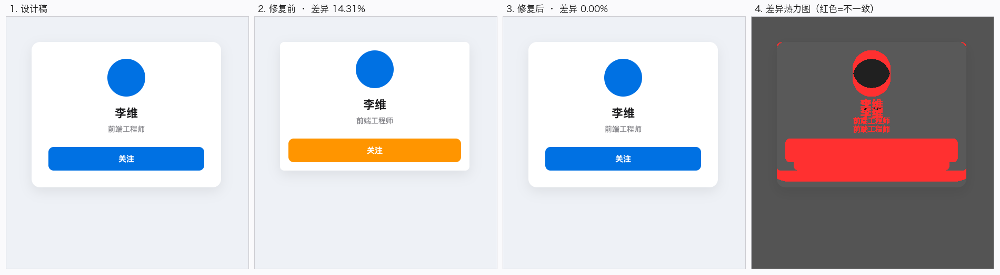
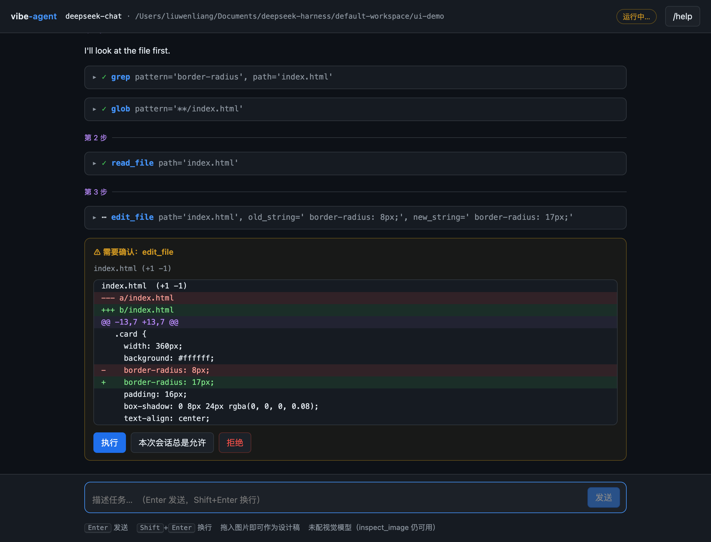

# vibe-agent

一个**从零构建**的终端编码 agent，对标 DSH / Codex 这一类工具。
不依赖 LangChain / LlamaIndex 等框架——工具循环、流式聚合、上下文压缩、路径沙箱、
diff 生成、文件快照、会话持久化、UI 渲染闭环全部自己实现，每一行都能看懂、能改。

支持 **Docker 一条命令在任意机器上跑起来**，也可以直接在本地用 Python 运行。

> 要部署到别的机器？看 **[DEPLOY.md](DEPLOY.md)**，或者直接：
> `./scripts/package.sh` 打包（约 190KB）→ 拷过去 → `./scripts/install.sh`。

---

## 快速开始

### 方式一：Docker（推荐，无需装任何东西）

```bash
cd vibe-agent
cp .env.example .env            # 填 VA_API_KEY
docker compose build            # 首次构建约 5~10 分钟（含 Chromium）
docker compose run --rm va      # 交互模式
```

工作区默认是当前目录。要跑别的仓库：

```bash
WORKSPACE=/path/to/your/repo docker compose run --rm va
```

### 方式零：浏览器界面（最省事）

```bash
python3 run.py web
```

浏览器会自动打开 `http://127.0.0.1:8420`。终端能做的那里都能做，
终端做不到的它也能做——**把设计稿直接拖进窗口**、彩色 diff、点按钮审批、滚动回看。

详见 [浏览器界面](#浏览器界面)。

### 方式二：本地 Python

```bash
cd vibe-agent
python3 -m venv .venv && source .venv/bin/activate
pip install -r requirements.txt             # 核心依赖
pip install -r requirements-browser.txt     # 可选：UI 渲染与截图对比
cp .env.example .env                        # 或用 python3 setup_key.py 安全录入
python3 run.py
```

### 配置模型服务

第一次启动会**自动进入配置向导**（检测到没配 key 且在交互式终端里）：

```bash
python3 run.py
```

向导会问三件事，然后把服务商支持的模型清单拉下来存好：

```
  选一个模型服务：
    [1] DeepSeek     https://api.deepseek.com/v1
    [2] OpenAI       https://api.openai.com/v1
    [3] 本地 Ollama    http://localhost:11434/v1
    [4] 自定义          （手动填写）

  > 1
  粘贴 DeepSeek 的 API key: （不回显）

  正在向 https://api.deepseek.com/v1 查询可用模型…
  ✓ 拿到 2 个模型，其中 1 个能读图

  发现 2 个可用模型：
    [ 1] deepseek-chat  ← 建议
    [ 2] deepseek-flash  ← 可读图
    DeepSeek-V4.1-Flash  1048k 上下文  可读图

  选哪个？输入序号或模型名，回车用「deepseek-chat」:

  ✓ 发现能读图的模型：deepseek-flash
    用它做视觉模型，agent 就能读懂设计图上的文字和语义。
    同一个 key 就能用，不需要另外申请。
  用它做视觉模型吗？[Y/n]
```

也可以显式跑：

```bash
python3 run.py setup              # 或 python3 setup_key.py
python3 run.py setup --force      # 已经配过也想重配
```

**模型清单会缓存下来**（`.models.json`），之后换模型不用再翻文档。

终端里直接打 `/model`，进交互式选择器——**上下键移动、回车确定**：

```
› /model

  选择模型
  ↑↓ 移动 · Enter 确定 · Esc 取消

   ❯ deepseek-chat      当前
     deepseek-flash     可读图
     deepseek-v4-pro
```

浏览器界面里就是顶栏的下拉框，点一下即可。

另外两种方式：

```
› /models                 # 纯文本列出（不进选择器，便于复制）
› /model deepseek-flash   # 直接指定，跳过选择器
```

三者都会**写进 `.env` 持久化**，下次启动还是它。

> 顺带一提：**视觉模型不一定非要另开一家**。上面这个例子里 DeepSeek 自己的
> `deepseek-flash` 就支持图片输入，同一个 key 就能用来读设计稿。

### 先自检一下

不管用哪种方式，先跑这个，它会告诉你这台机器还缺什么、怎么装：

```bash
python3 run.py doctor
docker compose run --rm va doctor
```

```
  vibe-agent 环境自检
  ──────────────────────────────────────────────────────────────
  工作区 /workspace

  必需
    ✓ Python       3.12.8  (Linux aarch64)
    ✓ 工作区          /workspace
    ✓ 会话目录         /workspace/.va/sessions
    ✓ git          git version 2.43.0
    ✓ git 身份       dev <dev@example.com>
    ✓ 模型连通         deepseek-chat   0.81s   → '连通'

  可选
    ✓ Node.js      v22.11.0  /  npm 10.9.0
    ✓ playwright   1.49.0
    ✓ 浏览器          Playwright 自带 Chromium（bundled）
    ✓ Pillow       11.0.0
    – 视觉模型         未配置
        可选。让 agent 把截图和设计图做比对时需要一个多模态模型，
        设置 VA_VISION_MODEL / VA_VISION_BASE_URL / VA_VISION_API_KEY

  ✓ 必需项全部通过。
  必需 6/6 · 可选 4/6 可用
```

退出码可直接用于 CI：必需项有失败才返回 1。`--json` 输出机器可读格式，
`--offline` 跳过网络检查，`--quick` 跳过浏览器实际启动探测。

---

## Docker 部署

### 为什么不是「装好 Python 就行」

编码 agent 会碰这些东西：git、Node（前端项目）、浏览器（渲染 UI）、
以及一堆系统库。在别人机器上逐个装一遍是最容易劝退的环节。所以镜像把
这些全带上，用构建参数控制取舍：

```bash
docker build -t vibe-agent .                              # 全功能（默认）
docker build -t vibe-agent --build-arg WITH_BROWSER=0 .   # 精简：不装 Chromium（省 ~1.5GB）
docker build -t vibe-agent --build-arg WITH_NODE=0 .      # 不装 Node
```

### 可选依赖在部署时安装

有两层机制，按你的场景选：

**构建时装好**（启动快，适合固定环境）——默认行为，`WITH_BROWSER=1` 时镜像里
就有 Chromium，容器起来直接用。

**运行时补装**（镜像小，适合不确定要不要用的场景）：

```bash
docker build -t vibe-agent --build-arg WITH_BROWSER=0 .
docker run --rm -it -e VA_INSTALL_BROWSER=1 -v "$PWD:/workspace" vibe-agent
```

entrypoint 会检测到缺 playwright/Chromium 并自动安装，装完留个标记文件，
重启不会重复装。下载的内容落在 `/opt/ms-playwright`，可以挂成卷复用。

### 挂载卷与权限

```yaml
volumes:
  - "${WORKSPACE:-.}:/workspace"   # 你的代码
  - va-home:/home/va               # git 配置、各类缓存
```

容器以 root 启动，但 entrypoint 会**先把内部的 `va` 用户对齐到你宿主机的
UID/GID**，然后降权执行。不对齐的话，工作区里生成的文件会归 root 所有，
你在宿主机上既改不动也删不掉——这是容器化开发工具最常见的坑。

默认取 `1000:1000`，宿主机用户 ID 不是的话显式传：

```bash
docker run --rm -it -e VA_UID=$(id -u) -e VA_GID=$(id -g) -v "$PWD:/workspace" vibe-agent
```

### 让 agent 能提交代码

容器里没有你的 `~/.gitconfig`，所以 git 身份得显式传：

```bash
docker run --rm -it \
  -e VA_API_KEY=sk-xxx \
  -e GIT_USER_NAME="你的名字" \
  -e GIT_USER_EMAIL="you@example.com" \
  -v "$PWD:/workspace" vibe-agent
```

不传也能跑，但 agent 执行 `git_commit` 时会失败在很晚的地方，entrypoint
启动时会提前提醒一次。

### 这套配置验证到什么程度

诚实说明，因为「没验证过」和「验证过」在出问题时差别很大。

**已经实测的**

- entrypoint 真跑过：非 root 路径、自动创建 `VA_WORKSPACE`、
  参数兜底（`docker compose run va doctor` 能正确变成 `python3 -m va doctor`）、
  `VA_INSTALL_BROWSER=1` 但非 root 时提示后继续（而不是崩）、
  未配 git 身份时的提醒、`safe.directory` 不重复累积
- 基础镜像 `python:3.12-slim-bookworm` 存在，且有 `amd64` / `arm64` 两个架构
- 全部 apt 包（`ca-certificates` `curl` `git` `less` `ripgrep` `gosu` `tini` `xz-utils`）
  在 Debian bookworm 里存在；`gosu` 装在 `/usr/sbin`（不是 `/usr/bin`）
- Node tarball 的版本发现逻辑：`x64` 与 `arm64` 都能正确解析出文件名，
  下载地址返回 HTTP 200
- 容器配置的一致性检查全部通过（见下方「测试」一节）

**没有实测的（本机没装 Docker）**

- `docker build` 全流程
- 镜像内 Chromium 是否真的能启动
- UID/GID 对齐在真实挂载卷上的效果

所以**首次构建请留意输出**。如果失败，最可能的位置是 Chromium 那一步
（`playwright install --with-deps`），其次是 Node 下载。两者都可以用
构建参数关掉来隔离问题：

```bash
docker build -t vibe-agent --build-arg WITH_BROWSER=0 --build-arg WITH_NODE=0 .
```

### 四个差点漏掉的坑

镜像没法在本机构建，所以这套配置额外请了一轮**对抗性审查**。它抓出了几个
「本机测不出来、但容器一跑就废」的问题，都值得记下来：

1. **`PYTHONPATH` 缺失。** compose 把 `working_dir` 设成 `/workspace`，
   覆盖了镜像的 `WORKDIR /app`。于是 `python3 -m va` 的 cwd 不在包目录里，
   直接 `ModuleNotFoundError`——而 README 里推荐的入口正是这条路。
   修法：镜像里显式 `ENV PYTHONPATH=/app`，让包的可见性与 cwd 解耦。

2. **compose 的裸 key 会删掉镜像的 ENV。** 写 `- VA_WORKSPACE`（只有 key
   没有值）时，如果宿主机没导出这个变量，docker 会把「没有 `=` 的条目」当成
   *删除该变量*，于是镜像的 `ENV VA_WORKSPACE=/workspace` 被抹掉。
   entrypoint 在 `set -u` 下裸用 `$VA_WORKSPACE` → `unbound variable` → 退出 1。
   同一个坑也适用于 `PLAYWRIGHT_BROWSERS_PATH`（被删后 playwright 回落到
   `~/.cache/ms-playwright`，找不到构建时装在 `/opt` 的 Chromium）。
   修法：这两个变量不从 compose 透传，用镜像默认值；entrypoint 里统一走
   `WS="${VA_WORKSPACE:-/workspace}"`。

3. **`docker compose run` 是替换 CMD 而不是追加。** 所以
   `docker compose run --rm va doctor` 到了容器里就变成执行一个叫 `doctor`
   的可执行文件，然后 not found。修法：entrypoint 里做参数兜底——第一个参数
   如果不是可执行文件，就当成 `va` 的参数。

4. **`ensure_workspace` 排在 `align_user` 之前（危险）。** 它会用旧 uid 去
   chown 挂载进来的宿主目录。在 Linux 上这会**真的改掉你本机那个目录的属主**；
   而且改完再对齐 uid，容器里的 va 反而写不了自己的工作区。
   修法：先对齐身份，而且只在 va 确实写不进去时才动属主、失败要打日志
   （原来被 `2>/dev/null || true` 吞掉了）。

### 环境变量

| 变量 | 默认值 | 说明 |
|---|---|---|
| `VA_API_KEY` | — | API key（也接受 `OPENAI_API_KEY` / `DEEPSEEK_API_KEY`） |
| `VA_BASE_URL` | `https://api.deepseek.com/v1` | 任何 OpenAI 兼容接口 |
| `VA_MODEL` | `deepseek-chat` | 主模型，需支持 function calling |
| `VA_VISION_MODEL` | — | 视觉模型，读设计稿用。**可以是同一家的多模态模型**，不必另开账号 |
| `VA_VISION_BASE_URL` | 同 `VA_BASE_URL` | 视觉模型接口 |
| `VA_VISION_API_KEY` | 同 `VA_API_KEY` | 视觉模型 key |
| `VA_WORKSPACE` | `/workspace` | agent 的工作区（沙箱根目录） |
| `VA_TEMPERATURE` | `0` | 编码任务建议保持 0 |
| `VA_MAX_ITERATIONS` | `200` | 单任务步数上限（**只是防跑飞的兜底**，不是任务能做多大的边界） |
| `VA_LOOP_REPEAT_LIMIT` | `3` | 同一工具用同样参数连续调几次就判定为原地打转（0 关闭） |
| `VA_MAX_DELEGATE_DEPTH` | `1` | 子 agent 最多嵌套几层（1 = 子 agent 不能再往下派） |
| `VA_AUTO_APPROVE` | `0` | `1` = 跳过所有审批（危险） |
| `VA_CONTEXT_BUDGET` | `60000` | 估算 token 超过此值就压缩历史 |
| `VA_SESSION_DIR` | `<工作区>/.va/sessions` | 会话文件位置 |
| `VA_BROWSER_CHANNEL` | 自动探测 | 指定 `chrome` / `msedge` / `chromium` |
| `VA_BROWSER_EXECUTABLE` | 自动探测 | 直接指定浏览器可执行文件 |
| `VA_INSTALL_BROWSER` | `0` | `1` = 启动时自动补装浏览器 |
| `VA_UID` / `VA_GID` | `1000` | 对齐到宿主机的用户/组 ID |
| `GIT_USER_NAME` / `GIT_USER_EMAIL` | — | 写入容器内 git 配置 |

---

## 功能开发流水线

```bash
python3 run.py feature "给用户列表加分页，每页 20 条，页码体现在 URL 里"
python3 run.py feature --doc docs/PRD.docx --design mockups/list.png "按需求文档实现列表页"
```

一条命令跑完六步：

```
1. 理解需求   读文档（read_document）、解析设计稿（read_design）
2. 读懂现状   glob / grep / read_file 摸清结构，找最接近的现有实现当参照
3. 实现       按计划逐步做，每步更新计划状态
4. 自测       跑测试/构建，UI 改动用 render_page 看真实效果
              ——没通过就修到通过为止
5. 独立审查   review_changes 起一个干净上下文的审查者，把需求原文一并给它
6. 提交       git_commit，跨多个不相关方面就拆成多个提交
```

**哪些是代码写死的**：建分支、状态检查、可选推送。
**哪些交给模型**：怎么拆计划、怎么写代码、审出来的问题怎么改。

三条刻意的约束：

- **关键决策先问，不自己拍板**。需求里没写清楚又会影响结果的地方，停下来问。
- **发现需求矛盾直接说**，不要硬做——硬做的结果是一堆需要返工的代码。
- **工作量远超预期就停**，别硬撑。

**刻意不自动推送。** 推送会把改动推给别人看到，这一步该由人决定。需要显式传 `--push`。

退出码也不只看「跑完了」：计划里还有未完成步骤时返回 1，提醒你可能漏了什么。

### 分支名怎么来的

从需求里的英文词生成：`add pagination` → `feat/pagination`。
纯中文需求抽不出英文词时退回时间戳（`feat/1023-1540`），
而不是硬编出一个 `feat/---`。也可以 `--branch` 自己指定，或 `--no-branch` 就地改。

---

## 规划层

多步任务不拆步骤，模型会来回打转、重复劳动、忘记做过什么。
更糟的是**上下文一压缩，中间那句「A 已经改完了」就没了**，它会从头再做一遍。

所以计划是一份**显式的、会被渲染出来的状态**，而不是模型脑子里的隐性推理：

```
● 第 4 步
  目标  给用户列表加分页
  进度  2/5

    ☑ 1. 读现有列表实现
    ☑ 2. 确定分页参数放哪
    ▸ 3. 实现 slice 逻辑
        ↳ 正在改 list.ts
    ☐ 4. 补测试
    ☐ 5. 提交
```

三个关键设计：

- **压缩后重新注入**。计划通常建在很早的步骤里，按「保留最近 N 条」的规则
  必然被丢掉。丢掉之后模型就忘了自己干到哪。
- **落盘到会话文件**，恢复会话时连计划一起恢复，并在第一轮的系统提示词里带上。
- **容错而非报错**。模型给出畸形步骤（未知状态、重复标题、一次两个 in_progress）
  时，能修的修、修不了的记成提醒——计划是辅助手段，格式问题不该打断正经工作。

---

## 子 agent 与独立审查

两种活会拖垮主对话：

1. 「在几十个文件里找出这个报错是谁抛的」——过程翻十几个文件，结论只有一行；
2. 「独立审查这份改动」——同一个上下文里，模型会顺着自己刚才的思路看，
   跳过那些「我本来就是这么想的」的地方，而那些恰恰是 bug 藏身处。

两者都能用「换个干净上下文去做，只把结论带回来」解决。

```
delegate(task, mode="read"|"write")   通用委派
review_changes(requirement=...)       专门的代码审查
```

| | read 模式 | write 模式 |
|---|---|---|
| 可用工具 | 只读的 11 个 | 加上写文件、跑命令、建分支、提交 |
| 不给 | 所有写操作 | `git_push`、`git_init`、`delegate` |

**刻意不允许递归委派。** 子 agent 拿不到 `delegate`——省下的那点并行度，
不值得换来失控的成本和难以追踪的调用链。

**审查者建议连需求原文一起给**，它才能判断「做对了没有」，
而不只是「代码写得对不对」。没给的话它会明确告诉你「需求符合度无法判断」，
而不是臆测一个需求出来。

**未跟踪的新文件也算进审查范围**——新写的代码同样需要审，
不能因为没 `git add` 就漏掉。

---

## UI 还原闭环

这是让 agent 真正能「照着设计稿做界面」的部分。四个工具分工：

| 工具 | 作用 | 花不花 token |
|---|---|---|
| `inspect_image` | **不需要任何模型**：尺寸、主色 hex、内容区边界、字符布局图 | 不花 |
| `read_design` | 设计稿图片 → 结构化文字规格，落盘到 `.va/designs/` | 花一次（需视觉模型） |
| `render_page` | 渲染页面截图，**顺带捞出控制台报错和资源加载失败** | 不花 |
| `pixel_diff` | 逐像素对比，给出差异百分比 + 差异热力图 | 不花 |
| `compare_with_design` | 调多模态模型，给出「哪里不像、该先改什么」 | 花 |

闭环是：**读设计稿 → 改代码 → render_page → pixel_diff / compare_with_design → 按差异改 → 再渲染**。

### 先说清楚：PRD 和 UI 图是两条完全不同的路

| 你手上是什么 | 用哪个工具 | 要视觉模型吗 |
|---|---|---|
| **PRD / 需求文档**（.docx / .pdf / .md / .html） | `read_document` | **不要**。纯文本抽取 |
| **UI 设计图**（截图 / Figma 导出 / 原型图） | `read_design` | **要** |
| UI 图，但不想配模型 | `inspect_image` | **不要**。给尺寸、配色 hex、布局结构 |

`read_document` 是零依赖的文本抽取：Markdown / 文本 / HTML 直接读，
`.docx` 要 `python-docx`，`.pdf` 要 `pypdf`（都在 `requirements-docs.txt` 里）。
**它和视觉模型没有任何关系**——PRD 是文字，不需要「看图」。

`.pdf` 有一个例外：**扫描件**（整页是图片、没有文字层）抽不出东西，
这时会明确告诉你去用 OCR 或 `read_design`，而不是返回一个空文档让你困惑。

### 没有视觉模型也能做 UI

`inspect_image` 纯靠像素统计，不调用任何 API：

```
主色（240 个采样格，按占比排序）：
  . #f0f0f0   54.6%  ██████████████████████  ← 背景
  # #ffffff   28.7%  ████████████
  ○ #3090f0    4.2%  ██

内容区：x 46~414，y 40~320（约 368x280，左边距 46，上边距 40）

粗粒度布局（20x12）：
  . . . . . . . . . . . . . . . . . . . .
  . . # # # # # # # # # # # # # # # ◆ . .
  . . # # # # # # ■ + + ? # # # # # # . .
  . . # # # # # # ? ? ▲ ? # # # # # # . .
  . . # ■ ○ ○ ○ ○ ○ ▲ ▲ ○ ○ ○ ○ ○ ? # . .
  . . # ? ● ● ● ● ● ● ● ● ● ● ● ● ◆ # . .
```

看布局图能直接读出结构：外圈是背景、中间一块白卡片、上方一个圆形、下方一条长条。
**配色直接是 hex，写 CSS 就能用。** 读不出来的只有文字内容和语义——
那才需要视觉模型。



上图是一次真实跑通的结果：左边是设计稿，第二个是故意埋了 3 个 bug 的实现
（圆角 8px 应为 16px、内边距 16px 应为 32px、按钮色写成了橙色），
第三个是修完之后的，最右边是差异热力图——红色精准框出了按钮、内边距和圆角三处。

像素差异从 **14.31% 降到 0.00%**。

### 为什么图片不进主对话

主模型往往不支持读图（`deepseek-chat` 就不支持），而且把 base64 塞进消息历史
会同时撑爆上下文和会话文件。所以读图只发生在工具内部，对外只返回文字结论。

`read_design` 更进一步：一次视觉调用换一份**结构化文字规格**，之后所有迭代
都走文字通道。这样纯文本模型也能做 UI，而这正是「读 UI 图」这个需求的解法。

规格会落盘到 `.va/designs/<图片名>.md`——它通常上千 token，实现到一半上下文被
压缩后仍然需要它，落盘之后 `read_file` 随时能取回。

### 为什么客观指标和主观判断分开

`pixel_diff` 给数字——「改了之后是不是更接近了」有个客观判据，不依赖模型自觉。
`compare_with_design` 给语义——「哪个位置、什么现象、应该是什么」。

两个都要。只看模型描述容易自我感觉良好，只看像素数字又不知道该改哪儿。

### 没有视觉模型怎么办

`pixel_diff` 完全不需要模型，照样能驱动迭代（差异百分比在降就是在收敛）。
只是少了「该改什么」的自然语言提示。

### 浏览器怎么找

不假设任何环境，按优先级探测，并把「试过哪些、为什么失败」如实报出来：

1. `VA_BROWSER_EXECUTABLE` 显式指定
2. `VA_BROWSER_CHANNEL` 显式指定
3. 系统 Chrome / Edge（macOS 的 `.app`、Linux 的常见命令名都会找）
4. Playwright 自带 Chromium

一个都找不到时会给出可执行的修复命令，而不是丢一句
`Executable doesn't exist` 让人自己猜。

---

## 长期记忆

`AGENTS.md` 是**项目级**的——换个项目就没了。但有些东西是跨项目通用的：
你的代码风格、提交信息习惯、内网镜像地址。每换一个项目重讲一遍很烦。

所以记忆存在**项目之外**，分两级作用域：

| 作用域 | 放哪 | 什么时候读 |
|---|---|---|
| **全局** | `<数据根>/memory/` | 所有项目 |
| **本项目** | `<数据根>/projects/<项目名-哈希>/memory/` | 只有这个项目 |

判断标准很简单：**换一个项目还成立吗？** 成立就写全局，不成立就写项目级。

### 数据仓库：一个仓库放全部数据

配了 `VA_DATA_REMOTE` 之后，记忆和所有项目的会话都自动进这个仓库：

```
ai-memory/
├── memory/                              全局偏好（所有项目都读）
│   └── 代码风格.md
└── projects/
    ├── vibe-agent-473b6107/
    │   ├── memory/                      这个项目自己的偏好
    │   │   └── 技术栈.md
    │   └── sessions/
    │       └── 20261010-153431-1b7c.jsonl
    └── shqfting-plant-web-a1b2c3d4/
        ├── memory/
        └── sessions/
```

**先按项目分，项目下再分**——打开仓库一眼就能看出哪个项目有哪些东西，
而不是一堆项目的记录混在一起。同名但不同路径的项目也不会撞
（目录名带路径哈希）。

点界面上的「同步」才会推送——**推送是外部可见的动作，不该自动做**。

### 为什么是 Markdown 文件

你要能直接打开看、直接改、直接 `git diff`。记忆一旦变成黑盒，人就不敢信它。

### 两个刻意的限制

**长度有上限。** 记忆每一轮都会进提示词，涨到几万字时每一轮都在烧钱。
超了会截断并**明确说明还有哪些没放进来**——悄悄吞掉比不注入更糟，
用户会以为记下来了。

**拒绝存密钥。** 记忆会进每一轮提示词，还可能被同步到 git 远端。
`remember` 检测到 `sk-`、`ghp_`、`password=` 之类会直接拒绝，
并告诉用户凭据该放 `.env`。

---

## 步数上限和「原地打转」

**跑了几轮不是进度，活儿干完没有才是。** 所以界面上不显示「第 N 步」——
一个正常任务跑几十轮是常态，标出轮次只会让人以为「怎么又要一步」。

上限仍然存在，但**换了个判据**：

| | 旧做法 | 现在 |
|---|---|---|
| 什么时候停 | 到 50 步就停 | 只有**原地打转**才停 |
| 默认值 | 50 步 | 200 步（纯兜底） |
| 停下时 | `[已达步数上限]` | 说清为什么停、怎么接着做 |

「原地打转」的判据是：**同一个工具用同样的参数连续调 3 次**。
只比对连续调用——中间插了别的动作说明它在推进，不算卡住。

这比按步数一刀切准得多：一个大重构跑 80 步是正常的，
原地转三圈是不正常的，而后者再给 200 步也只会重复那三圈。

真撞到上限时也不再假装任务完成：

```
⚠ 已经执行到步数上限（200 步）还没结束，先停在这里。
  两种可能：任务太大，或者卡在某个循环里。
  接着做：加大上限（--max-steps 500）后 /continue；或者把任务拆成几步分别交代。
```

阈值可以调：`VA_LOOP_REPEAT_LIMIT=0` 关掉检测，`VA_MAX_ITERATIONS` 改上限。

---

## 浏览器界面

```bash
python3 run.py web
```

```
  vibe-agent  浏览器界面
  工作区  /你的/项目
  模型    deepseek-chat
  按 Ctrl-C 停止
```

打开之后：



**它解决的是终端那些绕不过去的限制**：

| 终端 | 浏览器界面 |
|---|---|
| 图片只能给路径，或 `@clip` | **直接拖进窗口**，也能 Ctrl+V 粘 |
| diff 是带颜色的纯文本 | 真正的 diff 视图，加/删/位置分行着色 |
| 审批要敲 `y` / `a` / `n` | 点按钮，还能看到完整 diff 再决定 |
| 输出刷过去就没了 | 可滚动回看，工具结果折叠展开 |
| 长文本在窄终端里折行 | 正常排版，代码块有样式 |

### 界面上就能改配置

顶栏的 **⚙ 设置** 打开面板，不用去翻 `.env`：

| 设置 | 改完生效时机 |
|---|---|
| 会话保存位置（本地文件夹 / Git 仓库） | **立即**（新会话就用新位置） |
| 允许读取工作区外的文件 | 重启服务 |
| 视觉模型 | **立即** |
| 自动批准所有操作 | **立即** |
| 显示思考过程 | **立即** |

面板会**明确标出哪些要重启**，不会让你以为改了没生效。

**选目录是点按钮弹系统原生的选择框**，不用手打路径。浏览器出于安全
拿不到真实路径，但服务就跑在这台机器上，所以让它去弹框。弹不出来
（无图形界面、远程会话）会给出原因，旁边永远留着手输的位置。

改的是同一个 `.env`——命令行和界面改的是同一份配置，不会打架。
密钥不在面板里，也**不会被接口返回**（那条有专门的测试盯着）。

### 记忆和会话存哪：本地还是 git 仓库

面板上先选：

- **本地文件夹** —— 点「浏览…」选一个目录
- **同步到一个 Git 仓库** —— 填一个空仓库的地址，记忆和会话都写进本地克隆

> 这个地址是**记忆和会话记录**的仓库，**不是你项目代码的 git 远端**。
> 代码该推哪儿还是推哪儿，两者互不相干。建议单独开一个（比如 `ai-memory`）。

选远端后会有「立即同步」按钮。**推送只在点它时才发生**——
推送是外部可见的动作，不该自动做。

配了一个连不上的仓库会**当场报错并且不写进配置**。这条是刻意的：
否则会变成「我明明配了远端，记录却还在本地」这种最难查的状态。

### 常用参数

```bash
python3 run.py web --port 9000          # 换端口（被占用会自动换一个）
python3 run.py web -C /你的/项目          # 指定工作区
python3 run.py web -y                   # 自动批准（赶时间用，慎用）
python3 run.py web --continue           # 接着上次的会话
python3 run.py web --window             # 用原生窗口打开（需 pip install pywebview）
```

### Docker 里跑

```bash
docker compose up va-web
# 打开 http://127.0.0.1:8420
```

端口只映射到宿主机的回环地址。**这点是刻意的**——这 agent 能执行任意命令，
不该被暴露到局域网。镜像里监听 `0.0.0.0` 只是因为容器内的 `127.0.0.1`
从宿主机访问不到。

### 起不来 / 卡住了怎么办

**会话目录建不出来不会让服务挂掉。** 记录存不下是「少了个功能」，
不是「没法干活」——会降级成不记录，并在界面上说明原因和怎么改：

```
⚠ 建不出会话目录 /Users/you/.vibe-agent/sessions/xxx：[Errno 13] Permission denied
⚠ 本次不会被记录，其他功能照常。
```

**浏览器关掉之后，挂着的审批会自动按拒绝处理。** 不这么做的话 worker 会
干等到超时，界面上表现为「一直显示运行中，发什么都说上一个任务还在跑」。
状态标签带运行时长（`运行中 12s`），就是为了让你分得清「在干活」和「卡住了」。

### 它是怎么接上去的

`UI` 从一开始就是个抽象类，终端只是它的一个实现。所以加浏览器界面
**没有动核心一行代码**——新写一个 `WebUI` 实现同样的 18 个方法即可。

线程模型：

```
主线程     http.server 在 serve_forever
worker     一个任务跑在这里（同一时刻只有一个）
SSE 连接   每个标签页一条，从事件日志按序号读
```

两个关键设计：

- **事件用「有序日志 + 序号」而不是队列**。浏览器断线重连后要能按序号补发，
  队列读过就没了。
- **审批必须阻塞 worker 线程**。终端里 `input()` 天然阻塞，到了 HTTP 里如果不显式
  阻塞，agent 会一路跑到底——审批卡片变成摆设，而且从界面上完全看不出来。
  测试里专门验了这点：审批弹出时文件必须还没被写。

### 零依赖

用的是 Python 标准库的 `http.server`，前端是一个单文件 HTML，**不引任何 CDN**，
断网可用。唯一的可选项是 `pywebview`（想要真窗口时才需要）。

---

## 文件都放在哪

**agent 的产物不进你的项目。**

```
~/.vibe-agent/               ← 用 VA_HOME 可以改
├── inbox/                   粘贴、拖拽进来的图片
├── designs/                 设计稿解析出的规格（.md）
└── screenshots/             渲染截图、差异热力图

<你的项目>/.va/sessions/      仅当那里已经有历史时（否则不再用）
```

**会话记录也在项目外**：`~/.vibe-agent/sessions/<项目名-哈希>/`。

用「目录名 + 路径哈希」是因为同名项目会打架——`~/work/api` 和
`~/personal/api` 是两个完全不同的项目，只按目录名存会搅在一起。

想让会话进 git 或同步盘（Dropbox / iCloud / 网盘），指过去就行：

```bash
VA_SESSION_DIR=~/Dropbox/vibe-agent-sessions
```

那个目录里是 `*.jsonl`，一个会话一个文件，直接 `git add` 就能版本化。

为什么这么分：

- **图片、规格、截图是中间产物**，堆在项目里就是垃圾——`git status` 一直脏着，
  还得你自己想起来加 `.gitignore`。它们也不属于你的代码。
- **会话记录也是**。以前它留在项目里，但那会弄脏 `git status`，还得让你
  自己去加 `.gitignore`。现在默认在项目外，位置可以用 `VA_SESSION_DIR` 改。

> 旧项目里已经有 `.va/sessions/` 的话，**会继续用那个位置**——
> 装作没看见等于把你的历史弄丢。启动时会提示一条搬迁命令，
> 什么时候搬由你决定。那种情况下 `.va/` 仍会自动加进 `.gitignore`。

设计稿规格放在 `~/.vibe-agent/designs/` 不影响 agent 取回它——
那个目录被自动加入了可读范围，上下文被压缩之后照样 `read_file` 拿得回来。

Docker 里 `VA_HOME` 落在 `va-home` 卷上，重启不会丢。

---

## 读工作区外的文件

设计稿和需求文档经常不在项目里——它们在 `~/Downloads`、`~/Desktop`、
或者某个共享目录。所以「读图片/文档」允许越界：

```
› 照着 ~/Desktop/首页设计稿.png 实现首页

  ⚠ 需要确认：read_design
  ⚠ 要读工作区外的文件：~/Desktop/首页设计稿.png

  读图片/文档允许越界（设计稿常常不在项目里），但每次都会先问。
  把这个目录加进 .env 就不用再问：VA_READ_DIRS=/Users/you/Desktop
  写操作和静默的文本读取仍然锁死在工作区内。
```

**每次都会先问，并把完整路径摆给你看。** 觉得烦就把它加进 `.env`：

```bash
VA_READ_DIRS=~/Desktop:~/Downloads
```

分隔符用系统路径分隔符（macOS/Linux 是 `:`，Windows 是 `;`），逗号也认。

### 放开了什么，没放开什么

| 操作 | 能否越界 | 为什么 |
|---|---|---|
| `read_design` / `inspect_image` | ✅ 按策略 | 用户明确递过来的文件 |
| `read_document`（PRD/PDF） | ✅ 按策略 | 同上 |
| `pixel_diff` 的基准图 | ✅ 按策略 | 设计稿可能是外部的 |
| **所有写操作** | ❌ 永远不行 | 沙箱的底线 |
| `read_file` / `grep` / `glob` | ❌ 永远不行 | **它们没有审批环节** |

「按策略」由设置里的**允许读取工作区外的文件**决定：

| 策略 | 行为 |
|---|---|
| **全部**（默认） | 任何位置都能读，**不再询问** |
| 只允许列出的目录 | 列出的免问，其余每次点同意 |
| 只允许工作区内 | 最严格，但桌面上的设计稿就读不了 |

默认是「全部」——设计稿和 PRD 经常不在项目里，每次点同意太烦。
介意的话在设置里收紧，**写操作不受这条影响**。

最后一行是刻意的。`read_file` / `grep` 是「自己找路」的工具——agent 遍历目录、
搜到文件就读，中间没有人点同意。放开它们等于让 prompt injection 能直接把
`~/.ssh/id_rsa` 读出来发走。而读图片是「用户指着一个文件说读它」，语义不同。

> 越界判定会把相对路径也先解析再比边界——`../outside.txt` 虽然叫「相对路径」，
> 但它恰恰能走出工作区，不能因为「相对」就放行。

---

## 把图片交给 agent

终端传的是按键，不是图片数据——在终端里直接 Ctrl+V 一张图，什么都不会发生。
所以用 **`@clip` 标记**：先在别处复制图片，然后在消息里写它。

```
› 照着 @clip 这个设计稿实现 index.html
  ✓ 已把剪贴板图片存为 .va/inbox/clip-20261008-165851.png
```

`@clip` / `@paste` / `@img` / `@图片` / `@剪贴板` 都认。取不到图时**这条消息不会
发出去**——否则模型会看到一个字面量 `@clip` 而不知所谓。

也可以单独存图：

```
› /paste                  # 存成 .va/inbox/clip-<时间戳>.png
› /paste 首页设计稿        # 指定名字
  ✓ 已存为 .va/inbox/首页设计稿.png（460x480）
  用法：在消息里直接写 @clip，它会自动替换成这个路径。例如：
    › 用 inspect_image 看一下 .va/inbox/首页设计稿.png，然后照着它实现
```

各平台怎么读剪贴板：

| 平台 | 方式 | 需要装什么 |
|---|---|---|
| macOS | 自带的 `osascript` | 什么都不用装 |
| Windows | PowerShell 的 `System.Windows.Forms.Clipboard` | 什么都不用装 |
| Linux | `wl-paste`（Wayland）/ `xclip`（X11） | 装一个 |

> macOS 上刻意**不走 System Events**——那会触发「自动化」权限弹窗。
> 直接问剪贴板不需要任何权限。

`a@clip.com` 这样的邮箱地址不会被误替换（标记后面不能紧跟 `.` 或字母数字）。
落盘前还会**真解码一次**：有些程序会把文本塞进剪贴板的图片类型里，
不校验的话坏文件会流到下游，到那时报错的地方离病因已经很远。

---

## 交互模式命令

```
/help            帮助                 /tools        列出工具（含副作用标记）
/feature <需求>  跑一遍功能开发流水线    /plan         查看当前任务计划
/paste [名字]    把剪贴板里的图片存成文件  /models       列出服务商支持的模型
/diff            本次会话所有文件改动   /undo [N]     撤销最近 N 次文件改动
/checkpoints     列出可撤销的步骤       /sessions     列出历史会话
/reset           清空对话历史          /compact      立即压缩上下文
/init            生成 AGENTS.md        /cwd          显示工作区
/exit            退出
```

子命令：

```bash
python3 run.py setup                                     # 首次配置模型服务
python3 run.py doctor [--offline] [--quick] [--json]    # 环境自检
python3 run.py feature "需求描述" [--doc X] [--design Y]  # 功能开发流水线
```

`/init` 会扫描项目并生成 `AGENTS.md`。之后每次启动，这个文件都会被自动读进系统提示词——
**这是让 agent 理解你项目约定最有效的一招**。

---

## 架构

```
run.py / va/cli.py        REPL、命令行、doctor / feature 子命令、会话恢复
        │
        ▼
va/loop.py   Agent        主循环：调模型 → 执行工具 → 结果回灌 → 再调模型
        │                 （含审批、参数容错、上下文压缩、快照、落盘）
        ├──► va/llm.py         OpenAI 兼容流式客户端，聚合 tool_calls 分片
        ├──► va/tools/         工具实现（23 个）
        │      plan.py         update_plan（计划）
        │      fs.py           read_file / write_file / edit_file / list_dir
        │      search.py       glob / grep
        │      shell.py        run_bash（超时、进程组清理、危险命令拦截）
        │      git.py          status / diff / log / 建分支 / 提交 / 推送
        │      render.py       render_page / pixel_diff / compare_with_design
        │      design.py       read_design（设计稿 → 文字规格）
        │      document.py     read_document（Word / PDF / HTML / Markdown）
        │      delegate.py     delegate（子 agent 委派）
        │      review.py       review_changes（独立审查者）
        │      context.py      WorkspaceTool 基类 + AgentContext
        ├──► va/workspace.py   路径沙箱：所有读写必须落在工作区内
        ├──► va/diffview.py    unified diff 生成、着色、统计
        ├──► va/history.py     文件快照 + 检查点栈（撤销）
        ├──► va/session.py     JSONL 会话持久化（含计划）
        ├──► va/plan.py        计划模型 + 看板
        ├──► va/feature.py     功能开发流水线
        ├──► va/browser.py     浏览器探测与启动（不假设环境）
        ├──► va/imaging.py     图片编码与像素对比（Pillow 可选）
        ├──► va/doctor.py      环境自检
        ├──► va/prompts.py     系统提示词
        └──► va/ui.py          终端渲染、diff 展示、审批询问
```

### 几个刻意的设计选择

**消息结构与 SDK 解耦。** `llm.py` 只产出 `AssistantTurn`，主循环只消费它。
换掉 openai SDK 或接 Anthropic，只需要改 `llm.py` 一个文件。

**沙箱是唯一入口。** 工具层不允许自己拼 `Path`，一律走 `Workspace.resolve()`。
越界访问只可能在一个地方发生，也只可能在一个地方被拦住。

**工具永不抛异常穿循环。** `safe_run()` 把所有异常转成模型能读的文本。
模型看到 `"错误：找不到 old_string"` 会自己调整，而不是让整个任务崩掉。

**可选依赖一律降级而不是崩溃。** 没装 playwright、没装 Pillow、没配视觉模型——
每种情况都给出「装什么 / 配什么」的具体命令，并告诉用户还有哪条不需要依赖的替代路径。

**审批看 diff，不看参数。** 工具实现 `preview(args)`，在动盘之前算出真实的
unified diff 摆给用户看。旧做法是把 `old_string` / `new_string` 两个文本块直接
倒出来让人自己比对——那不是审批，是让人签名一份看不清的合同。
预览还会**提前暴露必然失败的操作**（匹配不到、不唯一、目标是目录）。

**撤销按「文件改动」计数，不按「步骤」计数。** 实际使用中 agent 经常是
「改代码 → 跑测试 → 再改」。如果 `/undo` 按步骤回退，它会先消费掉「跑测试」
这个没有文件快照的步骤，报一句「无法撤销」，而真正该回退的编辑纹丝不动。

**有些操作就是无法撤销，就如实说。** `run_bash` 跑了任意命令、`git checkout`
换了整个工作树——标记为 `opaque`，撤销时明确报告，而不是假装成功。

**上下文压缩必须保住消息配对。** OpenAI 协议要求 `tool` 消息前面必须有对应的
`assistant.tool_calls`。压缩时 `_safe_cut_index()` 会往前找到一条 `user` 消息作为
切点，保证不会切出孤儿 `tool` 消息——否则下一次请求会直接 400。

**会话文件是追加写的。** JSONL，每轮往末尾 append 一行，写入 O(1)，
崩溃最多丢最后一行（读取时跳过残缺行）。压缩是整体替换，所以单独用
`compact` 记录存一份完整快照。

**恢复会话时最重要的是提醒模型「你记的东西可能过期了」。** 历史里的
`FAILED (failures=2)` 可能早就被修好了。恢复时会对比 git HEAD，
把漂移情况注入系统提示词，并要求模型动手前重新读文件。

**危险命令是硬拦截，不是审批。** `rm -rf /`、`mkfs`、fork 炸弹这类命令，
即使开了 `VA_AUTO_APPROVE` 也会被拒绝。

---

## 测试

```bash
python3 -m unittest discover -s tests -v     # 用现有环境，缺依赖的用例会跳过
make test-full                                # 装齐依赖后跑，零跳过
```

416 个测试，**不需要 API key**。缺可选依赖的用例会优雅跳过而不是变红——
同一个套件在「只有核心依赖」和「装了全部依赖」的环境下都能跑：

```
系统 python（仅核心）              416 tests, OK (skipped=20)
venv（playwright + Pillow + pyyaml）416 tests, OK (skipped=2)
```

| 文件 | 覆盖 |
|---|---|
| `test_smoke.py` | 假 LLM 驱动真实工具：读写、精确编辑、沙箱越界、审批拒绝、未知工具、参数畸形、步数上限、**原地打转检测**、git 操作 |
| `test_llm_stream.py` | mock OpenAI 服务真实走 HTTP + SSE，验证流式 `tool_calls` 分片拼接 |
| `test_diff_preview.py` | diff 引擎（含末行无换行符的经典坑）、工具预览、预览在审批中真的被用上 |
| `test_undo.py` | 快照语义、多步回退顺序、空步骤跳过、不可追踪操作的如实报告 |
| `test_session.py` | 追加写、压缩重放、残缺行容错、跨进程恢复、恢复时的过期提醒 |
| `test_render.py` | URL 解析、缺依赖的报错文案、真渲染截图、控制台报错捕获、元素截图、像素对比阈值 |
| `test_environment.py` | 自检报告聚合、各项检查、浏览器候选优先级与去重、缺依赖提示 |
| `test_plan.py` | 计划模型与容错归一化、压缩后重新注入、落盘与恢复、看板接线 |
| `test_design.py` | 设计稿解析管线：提示词要求、图片真的作为图片传进去、规格落盘与截断 |
| `test_document.py` | Markdown/HTML/Word/PDF 抽取、章节切片、扫描件与缺依赖的提示 |
| `test_delegate.py` | 只读/写模式工具集、不递归、上下文隔离、撤销栈共享 |
| `test_review.py` | 审查者只读、未跟踪文件纳入范围、缺需求时不臆测、任务书构建 |
| `test_feature.py` | 分支名生成、六步任务书、建分支与退出码、不自动推送 |
| `test_docker.py` | 容器配置一致性（见下） |

### 为什么给容器配置写测试

本机没装 Docker，镜像从没被真正构建过。但容器化事故绝大多数来自**不一致**
而不是复杂逻辑，而不一致是能在本地断言的：

- Dockerfile `COPY` 了不存在的文件 → 构建到一半才炸
- `.dockerignore` 忘了排除 `.env` → 密钥被烤进镜像层
- `.dockerignore` 忘了排除 `.venv` → 宿主机二进制被带进 Linux 镜像
- **代码读了某个 `VA_*` 变量，compose 却没透传** → 「本地能跑、容器里怎么都不生效」
- entrypoint 没有可执行位 → 容器以 126 退出
- 关键步骤被 `|| true` 吞掉 → 现象和真因对不上

最后那条环境变量一致性检查是真的扫描源码：Python 里的 `os.environ.get(...)`
加上 shell 里的 `${VAR:-默认}`，再和 compose 的 `environment` 列表做差集。
它当场就抓到了一个真实遗漏——`config.py` 支持 `OPENAI_API_KEY` /
`DEEPSEEK_API_KEY` 作为兜底，compose 却只透传了 `VA_API_KEY`。

---

## 路线图

- [x] **Phase 1 · 内核** —— 工具循环、流式聚合、沙箱、审批、上下文压缩、核心工具集、CLI
- [x] **Phase 2 · 干活能力** —— diff 预览、撤销、会话持久化
- [x] **Phase 3 · 可移植 + UI 闭环** —— Docker 化、环境自检、浏览器探测、
      渲染截图、像素对比、设计稿多模态比对
- [x] **Phase 4 · 自主开发** —— 规划层、需求文档与设计图输入、子 agent 委派、
      独立审查者、`va feature` 六步流水线

---

## 开发过程中被真实使用抓出来的 bug

单元测试通不过的地方，往往不是真问题；真问题都是跑起来才露头的。记录在此：

1. **git porcelain 解析错位** —— `_git()` 对 stdout 做了 `strip()`，而
   `git status --porcelain` 的行首空格是有语义的（`' M'` = 未暂存，`'M '` = 已暂存）。
   结果文件名少一个字符（`__pycache__` → `_pycache__`），且暂存状态判断完全反转。

2. **多步撤销顺序反了** —— 用了 `reversed(taken)`，撤销 3 步后文件停在第 2 步的
   状态而不是最初状态。正确顺序是从最新往最老依次还原。

3. **撤销被空步骤吃掉** —— `/undo` 消费掉了没有文件快照的 `run_bash` 步骤，
   真正的编辑纹丝不动。改成按「文件改动」计数。

4. **嵌套 Playwright 实例** —— `render_page` 在 `with sync_playwright()` 里面调
   `detect()`，而后者自己又开一个实例；sync API 不允许重入，导致**所有**候选浏览器
   都以 `Error` 失败。必须先探测、再进上下文。

5. **异常类名毫无信息量** —— 上面那个 bug 一开始报的是
   `没有找到可启动的浏览器（试过：Google Chrome: Error、系统 chrome: Error…）`。
   Playwright 的异常类名就叫 `Error`，只报类名等于没报。改成取消息首行。

6. **打包时 bsdtar 偷偷塞了 74 个垃圾文件** —— macOS 的 bsdtar 会把扩展属性
   写成 `._` AppleDouble 条目打进包，**它自己读的时候会隐藏这些**，所以
   `tar -tzf` 看着干干净净；只有用 Python 的 `tarfile` 去读才发现 148 条里
   有 74 条是垃圾。Linux 上用 GNU tar 解压时它们会原样出现。

7. **测试把开发者的 API key 删了** —— `test_packaging.py` 最初直接对真实仓库
   操作：setUp 用金丝雀内容覆盖真的 `.env`，tearDown 再把它删掉。跑一次测试
   密钥就没了，而且本机没配 Time Machine，无法恢复。
   现在改成先拷一份仓库、只对副本操作，并在 tearDown 里核对真实 `.env` 的
   指纹——一旦被改动就立刻失败。**测试碰真实用户数据这件事，代价高得离谱。**

---

## 已知边界

- 只能读写工作区内文件（这是刻意的安全设计）。
- 单文件超过 2MB 拒绝读入；超过 5MB 不做撤销快照（该步标记为不可撤销）。
- 命令输出超过 30k 字符会头尾截断；最多保留 50 个撤销检查点。
- `run_bash` 默认超时 120s，上限 900s。
- 上下文压缩会丢失细节，摘要提示词里明确要求模型「需要细节时重新读文件」。
- 会话文件默认写在 `<工作区>/.va/sessions/`，截图在 `<工作区>/.va/screenshots/`。
  在 git 仓库里启动时，如果没忽略 `.va/`，会提醒一次（不会替你改 `.gitignore`）。
- `pixel_diff` 对**抗锯齿和字体渲染**敏感，默认阈值 16 是为了压掉这类噪声；
  但它仍不适合判断「设计上是否等价」，只能判断「像素上是否接近」。
- 容器镜像全功能版约 2GB（其中 Chromium 约 1.5GB），精简版约 300MB。
